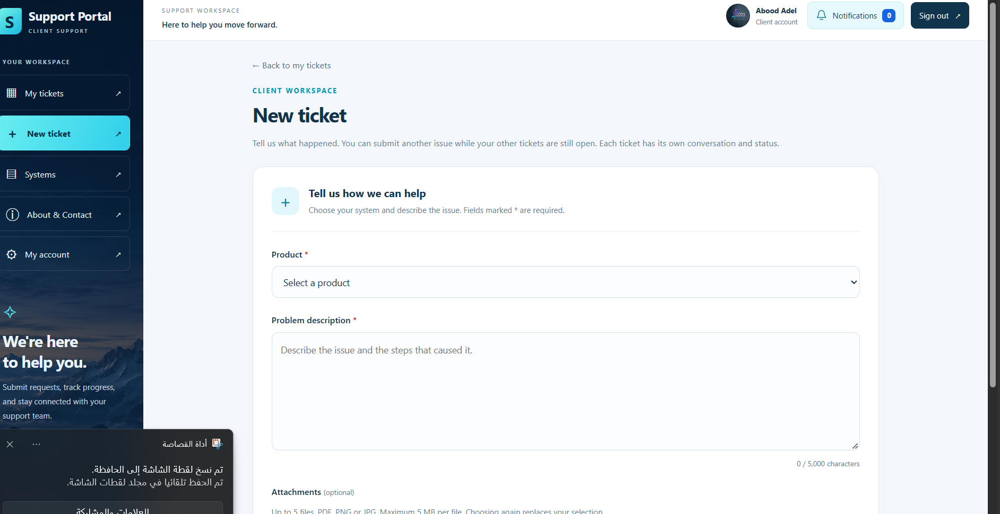
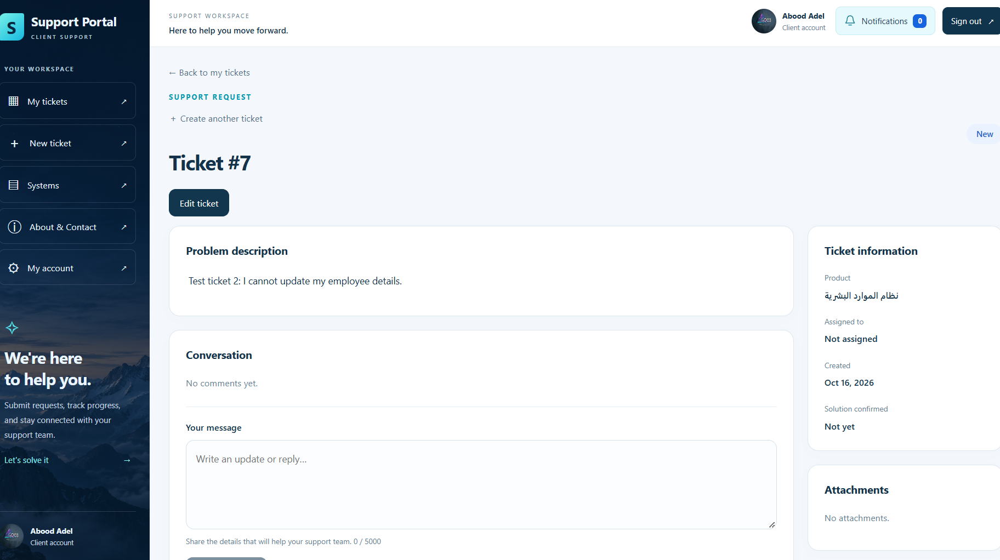

# Client Support Ticketing System

A training project for submitting product support requests, coordinating a support team, and following each request through resolution.

## Features

- Clients register, sign in, submit and edit tickets, upload attachments, and follow conversations.
- A ticket supports multiple messages and replies under the **same ticket number**. Use **Send comment** to follow up; **New ticket** creates a separate request.
- Clients can have multiple open tickets at the same time.
- Managers manage clients and employees, activate/deactivate accounts, filter tickets, assign/reassign employees, and view dashboard statistics.
- Assigned support employees reply, update ticket status, mark a solution, and close a ticket after client confirmation.
- Clients can edit their profile, phone, address and photo; change their password; and confirm an email change through their new mailbox.
- Email password recovery uses time-limited, single-use links.
- Role-based authorization, authenticated attachment access, notifications, health checking, and frontend/backend logging.

## Screenshots

### Submit a support request


### Follow up in the same ticket


The screenshots show demonstration data. Product names and user-entered content may be Arabic; interface labels are English.

## Technology and architecture

| Layer | Technology | Folder |
|---|---|---|
| Presentation | Angular 22, TypeScript, HTML, CSS | `Frontend` |
| Business / API | ASP.NET Core Web API targeting .NET 6 | `Backend/Client Support Ticketing System/Client Support Ticketing System` |
| Data access | Entity Framework Core 6, repositories and unit of work | `Backend/Client Support Ticketing System/SupportTicketingSystem.DataAccess` |
| Database | Microsoft SQL Server | Local instance configured by the operator |

Controllers accept HTTP requests, services implement business rules, and the data access project persists entities. Some existing dashboard queries live in the tickets controller. Frontend route guards control navigation; the API independently enforces authorization.

## Prerequisites

- SQL Server and a local database connection.
- A .NET SDK capable of building `net6.0` and the .NET 6 runtime. **.NET 6 is out of support; upgrade before public deployment.**
- Compatible Node.js/npm for Angular 22. The development environment used Node 24.
- SMTP credentials only if testing password recovery or email changes.

## First-time setup

These instructions use Windows CMD from the repository root.

1. Generate local configuration:

```cmd
powershell -NoProfile -File Configure-Local.ps1
```

Enter your SQL Server connection string when prompted. This generates a random JWT signing key and a local ignored `appsettings.Development.json`. Do not upload that file.

2. Create an empty database using migrations:

```cmd
cd "Backend\Client Support Ticketing System"
dotnet tool install --global dotnet-ef --version 6.0.0
dotnet ef database update --project SupportTicketingSystem.DataAccess --startup-project "Client Support Ticketing System" -- --environment Development
```

Skip tool installation if a compatible `dotnet-ef` is already installed. Use a separate database for testing. To transfer existing data, restore a private backup separately instead of overwriting your working database. Existing uploaded files are stored separately under `App_Data` and are not part of a database backup or this repository.

3. Review and run `SupportTicketingSystem.DataAccess/CreateSupportManager.sql` in SSMS against the intended database. The script uses the training database name `ClientSupportTicketingSystemDb`; adapt it if necessary. It seeds a demo manager. Replace demo credentials for actual use. Provision product records before submitting tickets; the application currently lists products but has no product-management CRUD screen.

4. Install frontend dependencies from the repository root:

```cmd
cd Frontend
npm ci
```

Clean-machine setup and migrations have not been re-tested end to end for this delivery copy.

## Run locally

Open two CMD windows from the repository root.

Backend:

```cmd
cd "Backend\Client Support Ticketing System\Client Support Ticketing System"
set ASPNETCORE_ENVIRONMENT=Development
dotnet run -- --urls "https://localhost:7200;http://localhost:5110"
```

Frontend:

```cmd
cd Frontend
npm start
```

- Application: http://localhost:4200/login
- API health: https://localhost:7200/api/health
- Swagger in Development: https://localhost:7200/swagger

If HTTPS development certificates are not trusted, run `dotnet dev-certs https --trust` locally. Keep both terminals open. Stop an older backend with Ctrl+C before rebuilding if Windows reports a locked DLL. SMTP settings are loaded at startup, so restart the backend after changing them.

## Email setup

Run this locally from the repository root; it prompts for credentials without placing them in source code:

```cmd
powershell -NoProfile -File "Backend\Client Support Ticketing System\Configure-RecoveryMail.ps1"
```

The helper uses Gmail STARTTLS and stores configuration in development user-secrets. Use your own Gmail account and app password. Those credentials are **not included**. Password recovery sends to the email of an active registered application account. The sender mailbox alone does not create a client account. Localhost links only work on the machine running the frontend. See `Backend/Client Support Ticketing System/PASSWORD-RECOVERY.md` for limitations.

## Dashboard demonstration

Sign in as a manager and open Dashboard. Counts and charts come from database records: create client tickets, assign them to employees, exchange comments, confirm a solution as the client, and close it as the assigned employee. Refresh the dashboard to view updated statistics. Do not type artificial totals into the frontend. Productivity is based on the implemented assigned/closed ticket counts, not a complete employee performance score.

## Main files

- `Program.cs`: dependency injection, SQL Server, JWT validation, CORS, middleware and health endpoint.
- `Controllers`: authentication, accounts, clients, employees, tickets, products, recovery and notifications.
- `Services`: ticket workflow, profile management, email recovery, images, attachments and notifications.
- `DTOs`: request validation and response models.
- `Context/AppDbContext.cs`: EF Core entities, relationships and indexes.
- `Models`: users, products, tickets, comments, attachments and notifications.
- `Repositories`, `Interfaces`, `UnitOfWork`: database operations and save coordination.
- `Migrations`: database schema history.
- `Frontend/src/app/app.routes.ts`: page routes and guards.
- `Frontend/src/app/core`: authentication, request interceptor, guards, UI logging and date validation.
- `Frontend/src/app/features`: authentication, account, tickets, manager, systems and company screens.
- `Frontend/src/app/layout`: client and employee navigation/layouts.

## Verification and remaining limits

Builds passed during development. Isolated HTTP integration tests verified two clients creating three simultaneously open tickets each, list ownership and denied cross-account details. Account and recovery checks covered token expiry/reuse, password checks, profile operations and frontend error handling. Real email password recovery was confirmed by the project owner. Name updates were confirmed after reload.

Not every account operation has been confirmed against the live SQL Server through the browser: phone edits, photo removal, current-password change and new-email confirmation still need a final delivery walkthrough. Existing CSS size warnings remain. A full dependency vulnerability audit and clean-machine startup are not certified. Email queues/rate limits are in-memory for a single-server training deployment. No nested tickets with independent statuses are implemented; conversations stay under their parent ticket.

Database backups, local settings, user images, ticket attachments and build artifacts are intentionally excluded. No claim of public-production readiness is made.
